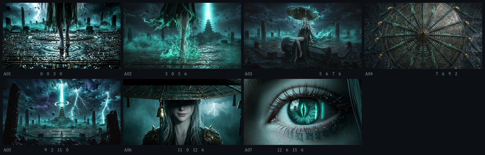

# 青冥 · 伞 — 40 秒漫剧打斗先导片（AI 复刻工程）

> 目标：以 `original-720p.mp4`（39 s 漫剧打斗参考片）为标准，**复刻一条 40 秒的打斗短片**，
> 并把"怎么做出来的"全部落成可复现的文档与代码。



---

## 成片

| | |
|---|---|
| **成片（40.0 s · 23 镜）** | `out/青冥·伞_40s.mp4`（1280×720 / 30 fps / H.264 High / AAC 192k） |
| 里程碑版本 | `out/青冥·伞_v2_27.8s.mp4`（31.4s，17 镜）、`out/青冥·伞_风格验证片_15.6s.mp4`（15.6s，7 镜） |
| 完整音轨（40 s） | `out/score.wav`（立体声，程序化配乐，时间轴已对齐全片分镜） |
| 海报 | `out/poster.jpg` |
| 联络表 | `out/contact_sheet.jpg` |
| 角色卡 | `out/character_cards.jpg` |
| 完整 40 s 分镜 | `shots/shots.json`（23 镜，含运镜/特效/字幕/转场） |
| **评审子代理打分** | **91.8 / 100 · 等级 S**（`docs/07-评审报告.md`，独立量表；重跑 `python3 scripts/reviewer.py`） |
| 字幕 | `out/青冥·伞_40s.srt`（3 条旁白，与画面内竖排文案一致；`python3 scripts/make_srt.py` 可重生成） |
| 并排对照图 | `out/review/side_1..6.jpg`（成片 vs 参考片，按叙事功能逐对比较） |
| 关键帧 | 22 张全部完成（`assets/shots/`），角色/场景参考图见 `assets/keyart/` |

> **与参考片的实测差距**（详见 `docs/04-质检报告.md`、`docs/07-评审报告.md`）：
> 时长 40.0 s vs 39.0 s、亮度 70.0 vs 71.6、高光 p95 184.3 vs 174.7、青绿偏移 67.8 vs 63.4、
> **硬切 12 vs 12（已按"同一次剪辑不重复计数"去重）**、ASL 3.33 s vs 3.25 s、响度 −16.2 vs −15.9 dBFS；
> 唯一的结构性差距是**主体局部运动量 11.3 vs 31.7**（−64%），来自"静帧 + 2.5D"路线，
> 补齐方式见 `docs/02` 把 `motion` 段投给图生视频模型。

## 文档导航

| 文档 | 内容 |
|---|---|
| [`docs/00-参考视频拆解.md`](docs/00-参考视频拆解.md) | 参考片的量化逆向：切点、ASL、亮度/色偏曲线、响度、19 镜逐镜读图 |
| [`docs/01-制作圣经.md`](docs/01-制作圣经.md) | 创作思路、角色设定、场景、画面规范、VFX 清单、23 镜分镜表、文案 |
| [`docs/02-分镜提示词包.md`](docs/02-分镜提示词包.md) | 逐镜可直接投喂的提示词（关键帧 + 图生视频运动）、角色一致性规范 |
| [`docs/03-技术方案与工具链.md`](docs/03-技术方案与工具链.md) | 用了哪些工具、管线、算法、成本核算、已知差距、复现步骤 |
| [`docs/04-质检报告.md`](docs/04-质检报告.md) | 成片与参考片的逐项数值对比 + 自检清单 |
| [`docs/05-交付状态与下一步.md`](docs/05-交付状态与下一步.md) | 交付清单、配额说明、下一轮执行计划、达标判定 |
| [`docs/06-动作设计.md`](docs/06-动作设计.md) | **动作设计**：8 个攻防回合、招式力学与视觉签名、打击感四件套、节奏"敢停" |
| [`docs/07-评审报告.md`](docs/07-评审报告.md) | **评审子代理评分报告**（自动生成：维度得分/逐项实测/扣分项与建议） |
| [`docs/08-评审方法说明.md`](docs/08-评审方法说明.md) | 评审量表、三项防误判设计、三轮评审驱动的改动、可信度声明 |

## 快速复现

```bash
pip install --break-system-packages numpy pillow imageio-ffmpeg fonttools

python3 scripts/analyze_ref.py original-720p.mp4   # 1) 复现参考片拆解数据
python3 scripts/prep_assets.py                     # 2) 关键帧裁切 16:9 + 联络表
python3 -m render.render_video                     # 3) 出片（2 核 CPU ≈ 12 分钟）
python3 scripts/reviewer.py --side-by-side         # 4) 评审打分 + 并排对照图
python3 scripts/make_qc_doc.py out/青冥·伞_40s.mp4 40   # 5) 质检报告
python3 scripts/make_derived.py out/青冥·伞_40s.mp4     # 6) 海报/联络表/角色卡
python3 scripts/make_srt.py                       # 7) SRT 字幕
python3 scripts/make_shot_table.py --check        # 8) 校验 docs/01 分镜表与 shots.json 一致
```

沙箱/机器被重置后，先跑 `bash scripts/restore.sh`（备份 → git 同步 → 装依赖 → 自检 1200 帧）。

单镜头调试：

```bash
python3 -m render.render_video --only 11,17 --out out/debug.mp4 --no-audio
```

## 目录结构

```
├── original-720p.mp4          参考片（只做技法分析，不复用其角色/道具设计）
├── shots/shots.json           机器可读分镜表 —— 渲染的唯一排期真相
├── prompts/shots_prompts.json 逐镜提示词
├── assets/
│   ├── keyart/                角色定妆三视图 ×2 + 场景概念图
│   ├── shots/                 23 个镜头（22 张关键帧 + 1 张字幕卡）（16:9）
│   └── fonts/                 片名字体子集（26 KB）
├── render/
│   ├── render_video.py        合成主程序（运镜/VFX/调色/字幕/片名/编码）
│   └── lib/{core,vfx,shot,audio}.py
├── scripts/                   分析 / 素材预处理 / 文档生成
├── docs/                      00–04 文档
└── out/                       成片与衍生图
```

## 设计要点（一句话版）

- **结构照抄，符号原创**：继承参考片的"长铺垫 → 0.5 秒爆切 → 巨物反转"节奏公式，角色/道具/片名全部原创。
- **单一强色彩**：青绿 `#1F6B5E`/`#5FE3C0` + 古金 `#C9A24B`，全片占比 ≈ 60 / 7 %。
- **打击感四件套**：光 + 粒子 + 镜头抖 + 声音，每一击必须齐。
- **AI 只做质感，代码负责节奏**：图像模型出"真实感"，引擎管"什么时候动、动多快、响多重"。

## 免责声明

参考片仅用于结构与技法层面的分析；本片角色（玄罗 / 照雪 / 无相）、道具（九幽罗盘伞 / 素霜）、
片名与文案均为原创设定。成片含 AI 生成画面，公开发布需按平台要求标注"AI 辅助制作"。
